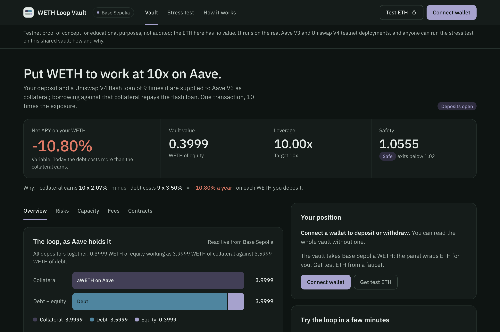

# Yield Bearing Vaults

[](https://github.com/GushALKDev/evm-yield-bearing-vaults/actions/workflows/ci.yml)
[](LICENSE)
[](https://docs.soliditylang.org/)
[](https://getfoundry.sh/)

A modular ERC-4626 vault with pluggable strategies. The repository contains a simple Aave V3 supply strategy and a leveraged WETH loop strategy that uses Uniswap V4 flash loans and Aave V3 E-Mode.

> **Proof of concept for educational purposes. Not audited, and not deployed on any mainnet.** The only deployment tooling targets a testnet (`script/testnet/`). Do not use this code with real funds.

**Demo app:** a web interface in [`app/`](./app/README.md) runs the vault on Base Sepolia against the real Aave V3 and Uniswap V4 deployments: deposit, withdraw and run the exit-before-liquidation cycle, with previews computed by the contracts' and Aave's own math.

**Live demo:** https://vaults-poc.tesselium.com

[](https://vaults-poc.tesselium.com)

---

## Highlights

- **Vault and strategy split.** `YieldBearingVault` is an ERC-4626 vault that holds shares of a single ERC-4626 strategy. Deposits reach the strategy in the same transaction; withdrawals use the vault's idle balance first and take only the shortfall from the strategy.
- **Leverage in one transaction.** `WETHLoopStrategy` builds a leveraged WETH position with a Uniswap V4 flash loan and Aave V3 E-Mode, and unwinds it proportionally so a withdrawal never increases leverage.
- **Exit before liquidation.** A permissionless `checkHealth()` closes the whole position when the Aave health factor drops below a threshold. Emergency mode blocks deposits but not withdrawals, which pay the pro rata share of equity.
- **ERC-4626 limits that match the code.** `maxDeposit` and `maxMint` return 0 during emergency mode, for receivers outside the whitelist and when an investment would end below the minimum health factor; `maxWithdraw` and `maxRedeem` are capped by the flash loan and Aave liquidity available now. Previews and conversions include the pending performance fee.
- **High-water mark fee.** Performance fees are charged only on gains above the previous high-water mark, assessed before each deposit, mint, withdraw and redeem is priced, and minted as shares to a whitelisted recipient.
- **Tested against mainnet.** Fork suites run against Aave V3 and Uniswap V4 at a pinned block, next to 27 stateful invariants. A review of the docs, tests and code found 18 issues, each fixed with a regression test that failed before the fix.

---

## Demo app

A web app (`app/`) runs the vault on Base Sepolia against the real Aave V3 pool, Uniswap V4 PoolManager and WETH of that testnet, with the test suite's parameters. Visitors can deposit testnet WETH, watch the loop as Aave holds it (collateral and idle WETH against debt and equity, projected to the second, with the health factor against its thresholds), withdraw, and run the emergency cycle themselves on a stress test page: a testnet-only contract, `DemoOperator`, holds the owner and admin roles and lets anyone join the whitelist, shock the thresholds above the live health factor, restore and reinvest. The previews are mirrored from the contracts and Aave with their rounding and checked against a Base Sepolia fork to the wei. How it is built, what the stand-in does and does not check, and how to deploy it: [app/README.md](./app/README.md). Live at https://vaults-poc.tesselium.com.

---

## Architecture

```
┌──────────────────────────┐
│           USER           │
└────────────┬─────────────┘
             │    ▲
      Assets │    │ vShares
             ▼    │
┌──────────────────────────┐
│    YieldBearingVault     │
│  (ERC4626, Whitelist)    │
└────────────┬─────────────┘
             │    ▲
      Assets │    │ sShares
             ▼    │
┌──────────────────────────┐
│         Strategy         │
│ (AaveSimple / WETHLoop)  │
└────────────┬─────────────┘
             │    ▲
      Assets │    │ aTokens / debt tokens
             ▼    │
┌──────────────────────────┐
│    External Protocols    │
│ (Aave V3 / Uniswap V4)   │
└──────────────────────────┘
```

| Contract | Role |
|----------|------|
| `BaseVault` / `YieldBearingVault` | ERC-4626 vault: whitelist, strategy integration, high-water-mark fee, emergency mode, 1,000 wei dead shares |
| `BaseStrategy` | ERC-4626 strategy that only accepts deposits from its vault, with `_invest()`, `_divest()` and `_exitPosition()` hooks |
| `AaveSimpleLendingStrategy` | Supplies the asset to Aave V3, no leverage |
| `WETHLoopStrategy` | Leveraged WETH through Uniswap V4 flash loans and Aave V3 E-Mode |
| `AaveAdapter`, `UniswapV4Adapter` | Aave V3 supply, withdraw, borrow and repay; flash loans through `unlock` / `unlockCallback` |

Every contract, the role matrix and the step-by-step flows: [Guide 1: Architecture and Flows](./docs/01-architecture.md).

---

## The WETH loop

**Investment.** The vault deposits `X` WETH. The strategy flash-borrows `X * (L - 1)` WETH from the Uniswap V4 PoolManager, supplies `X * L` to Aave, borrows `X * (L - 1)` at the variable rate, repays the flash loan and reverts if the health factor ends below `minHealthFactor`. A 1 WETH deposit at 10x ends as 10 WETH of collateral against 9 WETH of debt.

**Withdrawal.** To pay `N` WETH beyond its idle balance, the strategy repays `ceil(debt * N / equity)` of debt with a flash loan and withdraws that amount plus `N` of collateral, so the remaining equity is exact and leverage does not increase. Withdrawing half of a 10 / 9 position repays 4.5 WETH, withdraws 5 and returns 0.5.

**Emergency and recovery.** Emergency mode starts from `checkHealth()` or the admin and closes the position with a flash loan for the whole debt. If the exit fails, emergency mode stays on and withdrawals deleverage proportionally. Recovery takes two admin steps: clearing the flags, then `reinvest()`, which reverts unless the rebuilt position reaches `targetHealthFactor`.

The tests run at 10x. With the E-Mode LTV of 93% at the pinned block, Aave accepts a fresh position at 14x and rejects one at 15x.

---

## Economics: why the WETH loop has negative carry

Collateral and debt sit in the same Aave reserve, and a reserve pays its suppliers less than it charges its borrowers (`s = r * U * (1 - RF) < r`). Return on equity at leverage `L` is `L * s - (L - 1) * r`: at the rates of the pinned block (supply 1.41%, variable borrow 2.02%) that is about -4.1% per year at 10x. Debt also grows faster than collateral, so the health factor drifts down even when prices do not move: at those rates it takes about 5.6 years to fall from 1.0556 to 1.02, and a sustained 5 point spread would take about 8 months.

The loop demonstrates the leverage mechanics; a positive spread needs yield-bearing collateral such as an LST (see [Roadmap](#roadmap)). Derivation and figures: [Guide 2: Economics of the WETH Loop](./docs/02-economics.md).

---

## Trust assumptions

- **Admin powers.** The admin can replace the strategy (funds in the old one are not migrated), set the fee up to 25%, change the leverage and health factor thresholds and toggle emergency mode. There is no timelock.
- **Keeper liveness.** `checkHealth()` is permissionless, but the repository ships no keeper. If nobody calls it in time, the position can be liquidated.
- **Flash loan liquidity.** Investing, deleveraging and the emergency exit all borrow from the Uniswap V4 PoolManager. At the pinned block it held 1,004.74 WETH, which at 10x caps a single deposit at about 111.6 WETH.
- **Aave parameters.** The LTV, liquidation threshold and E-Mode category are set by Aave governance and can change under an open position.

The full list, with the permissioned whitelist, dust handling, the exit gas bound and the share inflation defenses: [Guide 3: Security](./docs/03-security.md).

---

## Repository layout

```
src/              protocol contracts (vaults, strategies, adapters, access)
test/             protocol tests: unit, fork integration, fuzz, invariants, gas benchmarks
script/testnet/   Base Sepolia deployment (DeployTestnet), the testnet-only DemoOperator, their tests
app/              demo app (React, viem, wagmi), its parity and end-to-end suites
docs/             guides: architecture, economics, security, review notes
```

---

## Testing

Measured at commit `51b3cf8` with Forge 1.7.1; fork suites run against Ethereum mainnet at block 26043110.

| Area | Result |
|------|--------|
| Tests | 367 passing: 199 unit, 88 fork integration, 53 stateless fuzz (22 mock, 31 fork), 27 invariants; plus 10 gas benchmarks |
| Fuzzing | 13,568 stateless runs and 345,600 invariant handler calls |
| Coverage | 98.60% lines, 94.00% statements, 74.11% branches, 100% functions |
| Review | 18 issues found and fixed, each with a regression test that failed against the code without its fix |

| Gas on the mainnet fork | |
|-------------------------|--:|
| `vault.deposit` of 1 WETH into an existing 10x position | 418,232 |
| `vault.withdraw` of 0.5 WETH from a 1 WETH position | 396,253 |
| `strategy.checkHealth` emergency divest of 10 WETH / 9 WETH | 345,280 |

Per-test breakdown, invariants, tolerances and every gas figure: [test/README.md](./test/README.md). Every review finding with its root cause and fix: [Guide 4: Review Notes](./docs/04-review-notes.md).

---

## Getting started

Requires [Foundry](https://book.getfoundry.sh/). Dependencies are git submodules pinned in `foundry.lock` (forge-std v1.14.0, OpenZeppelin Contracts v5.7.0, Uniswap V4 Core v4.0.0).

```bash
git clone --recursive https://github.com/GushALKDev/evm-yield-bearing-vaults.git
cd evm-yield-bearing-vaults
forge build
```

Tests that need no RPC (unit, mock fuzz, invariants and mock gas benchmarks):

```bash
forge test --no-match-path "test/{integration/*,fuzz/*StrategyFuzz.t.sol,gas/GasBenchmarkFork.t.sol}"
```

The fork suites need an Ethereum mainnet RPC that serves historical state for block 26043110. Copy `.env_example` to `.env`, set `ETHEREUM_MAINNET_RPC`, then:

```bash
forge test                                                         # everything
forge coverage --no-match-coverage "(test|script|mock)"
INVARIANT_USE_FORK=true FOUNDRY_PROFILE=fork-invariant forge test --match-path "test/invariant/*.sol" --threads 1
```

`FORK_BLOCK` overrides the pinned block (`FORK_BLOCK=0` forks the latest one); results at other blocks can differ from the figures above.

The testnet tooling has its own suite, kept out of the figures above; its fork tests read Base Sepolia (`BASE_SEPOLIA_RPC_URL`, default `https://sepolia.base.org`):

```bash
FOUNDRY_PROFILE=testnet forge test
```

---

## Roadmap

- [x] ERC-4626 vault
- [x] Aave simple lending strategy
- [x] Leveraged loop strategy (WETH)
- [x] Proportional deleveraging
- [x] Performance fee with high-water mark
- [x] Emergency mode circuit breaker with position exit
- [x] Permissionless health check with emergency divest
- [x] Two-step emergency recovery with a `targetHealthFactor` check on reinvestment
- [x] Fixes for the review findings (see [Guide 4: Review Notes](./docs/04-review-notes.md))
- [x] Test suite (367 tests plus 10 gas benchmarks, 98.60% line coverage)
- [x] Stateless fuzzing (53 tests, 13,568 runs)
- [x] Stateful fuzzing (27 invariant functions, 345,600 handler calls)
- [x] Gas benchmark harness (mock and fork)
- [x] Base Sepolia demo app and testnet tooling (2026-10-22)
- [ ] Keeper for `checkHealth()`
- [ ] Loop strategies with yield-bearing collateral (stETH, rETH, cbETH)
- [ ] Multi-asset vaults

---

## Documentation

| Document | Covers |
|----------|--------|
| [1. Architecture and Flows](./docs/01-architecture.md) | Contracts, roles, investment, divestment, emergency and recovery flows, gas optimizations |
| [2. Economics of the WETH Loop](./docs/02-economics.md) | Supply and borrow rates, return on equity, health factor drift |
| [3. Security](./docs/03-security.md) | Trust assumptions and limitations, security considerations |
| [4. Review Notes](./docs/04-review-notes.md) | The 18 review findings, root causes, fixes and regression tests |
| [Test suite](./test/README.md) | Every test file, coverage, fuzzing, invariants, gas benchmarks |
| [Demo app](./app/README.md) | The Base Sepolia app, the testnet stand-in, deployment and hosting |

---

## Tech stack

Solidity 0.8.26 (EVM Cancun, optimizer 200 runs) · Foundry · OpenZeppelin Contracts v5.7.0 · Uniswap V4 Core v4.0.0 · Aave V3 (mainnet deployment, through a local `IPool` interface)

## License

MIT, see [LICENSE](LICENSE).

## Author

[@GushALKDev](https://github.com/GushALKDev), Gustavo Martín ([LinkedIn](https://www.linkedin.com/in/gustavomaral/)).
